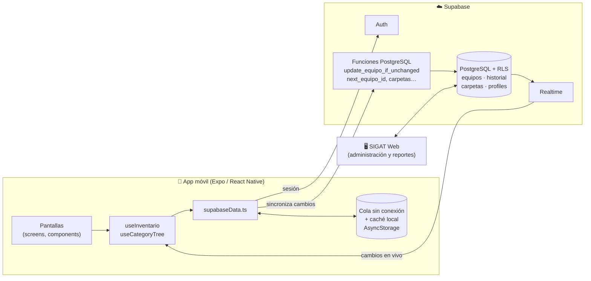
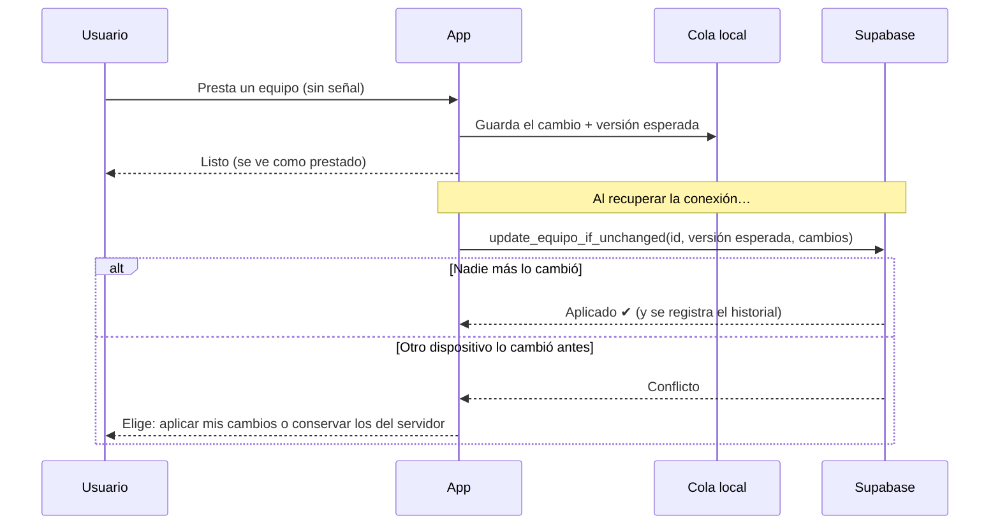

# SIGAT Móvil

[](https://github.com/Uliconda/sigat-movil/actions/workflows/ci.yml)


Aplicación móvil del **Sistema de Gestión de Activos (SIGAT)** del Centro de
Estudios Superiores del Bajío (CESBA). Controla el inventario de equipo de la
institución: registro de activos, préstamos y devoluciones con código QR, y
evaluación del estado físico de cada equipo al recibirlo.

Trabaja junto con **SIGAT Web** (panel de administración y reportes): ambos
comparten la misma base de datos y se actualizan en tiempo real.

## Qué resuelve

- Saber en todo momento **quién tiene cada equipo** y desde cuándo.
- Registrar préstamos y devoluciones **donde está el equipo** (almacenes,
  salones), aunque no haya buena señal de internet.
- Llevar registro del **estado físico** de cada equipo al devolverlo, para no
  volver a prestar uno que necesita reemplazo.

## Qué hace

| | |
|---|---|
| 📷 **Escanear y prestar** | Se escanea el QR del equipo, se capturan nombre y matrícula, y queda registrado. |
| 🔐 **Devolución verificada** | Para devolver hay que volver a escanear el QR del mismo equipo, y se evalúa su estado físico (bueno, aceptable, reemplazar). |
| 📶 **Funciona sin conexión** | Todo se guarda en el teléfono y se sincroniza al recuperar la conexión. |
| ⚡ **Tiempo real** | Lo que cambia en la web u otro teléfono aparece sin recargar. |
| 🗂️ **Inventario por carpetas** | Categoría › Subcategoría › Sección, con búsqueda por nombre, ID, marca, serie o persona. |
| 👥 **Roles** | Usuario (presta y recibe), administrador (registra y organiza) y superadministrador (elimina). |
| 🌗 **Modo claro y oscuro** | Sigue la configuración del teléfono. |

<!-- Capturas de pantalla: agregar en docs/capturas/ y descomentar.
| Inventario | Detalle | Escáner | Sin conexión |
|---|---|---|---|
|  |  |  |  |
-->

## Arquitectura



### Cómo funciona la sincronización sin conexión

Cada cambio (préstamo, devolución, alta, edición, baja) entra primero a una
**cola local** junto con la versión del equipo sobre la que se hizo. La
pantalla se actualiza al instante y la cola se envía cuando hay conexión:



El servidor compara la versión esperada **dentro de una transacción**, así que
dos teléfonos que prestan el mismo equipo sin conexión nunca se sobrescriben en
silencio.

## Decisiones técnicas

- **Seguridad en el servidor, no solo en la interfaz.** Los permisos se validan
  con RLS y funciones de PostgreSQL: un usuario normal solo puede prestar y
  devolver (el servidor revisa qué campos cambia y que la transición de estado
  sea válida), eliminar es exclusivo del superadministrador, y el historial
  guarda el autor real de cada movimiento.
- **Operaciones atómicas.** Reservar el siguiente ID `EQ-XXX`, renombrar una
  carpeta con todos sus equipos o eliminarla son funciones del servidor en una
  sola transacción, en lugar de muchas llamadas desde el teléfono.
- **Lógica pura separada.** `offlineQueue.ts` y `utils/carpetas.ts` no
  dependen de React ni de la red, lo que permite probarlos a fondo.
- **TypeScript estricto** con un modelo del dominio (`src/types.ts`): la cola
  sin conexión es una unión discriminada y las rutas de navegación están
  tipadas.
- **Compilaciones a prueba de errores de configuración:** EAS verifica las
  variables antes de compilar y la app muestra un mensaje claro si faltan.

## Calidad

```bash
npm test            # 74 pruebas con Jest
npm run typecheck   # TypeScript en modo estricto
npm run lint        # ESLint
```

GitHub Actions ejecuta las tres verificaciones en cada cambio. Las pruebas
incluyen integración del modo sin conexión contra un Supabase simulado en
memoria (`test/fakeSupabase.ts`): préstamo sin conexión → sincronización →
historial, conflictos y sus dos resoluciones, altas sin conexión, eventos en
tiempo real y reserva de IDs.

## Tecnologías

React Native 0.88 · Expo SDK 58 · TypeScript · React Navigation 7 ·
Supabase (Auth, PostgreSQL, Realtime) · AsyncStorage · Expo Camera · Jest ·
EAS Build · GitHub Actions

## Estructura

```
index.ts            Punto de entrada
App.tsx             Sesión, perfil y navegación
src/
  screens/          Una pantalla por archivo (Inventario, Detalle, Escáner, ...)
  components/       Piezas reutilizables (ProductForm, FormModal, EquipoCard, ...)
  navigation/       Menú lateral y pila de pantallas
  services/         Supabase y modo sin conexión (offlineQueue.ts es lógica pura)
  constants/        Estados, condiciones, roles y categorías
  utils/            Conteo y árbol de carpetas, búsqueda
  hooks/            useInventario (datos + tiempo real), useCategoryTree
  theme/            Colores claro/oscuro, useTheme() y estilos compartidos
  context/          AuthContext (usuario y perfil)
  types.ts          Modelo del dominio: Equipo, Carpeta, Perfil, cola, rutas
__tests__/          Pruebas con Jest (jest-expo)
scripts/            check-env.js (verificación previa a compilar)
```

## Desarrollo

### Configuración local

Crea `.env` (puedes copiar `.env.example`) con la URL del proyecto Supabase y
la clave **publishable**:

```dotenv
EXPO_PUBLIC_SUPABASE_URL=https://<project-ref>.supabase.co
EXPO_PUBLIC_SUPABASE_PUBLISHABLE_KEY=<publishable-key>
```

Las variables `EXPO_PUBLIC_*` se incluyen en la app, así que nunca uses la
clave `service_role` ni una clave `secret`. `.env` está excluido de Git.

### Base de datos

El esquema es compartido con SIGAT Web y vive en ese repositorio:
`sigat-web/supabase/migrations/20261020000000_initial_schema.sql`. Ejecútalo
completo en el SQL Editor de Supabase; se puede volver a ejecutar sin duplicar
nada.

### Ejecutar

```bash
npm install
npx expo start -c
```

Inicia sesión con una cuenta de Supabase Auth que tenga perfil SIGAT. Si la
cuenta tiene una contraseña temporal, la app pedirá cambiarla.

### Compilar con EAS

`.env` no se sube a EAS, así que sus variables deben registrarse en cada
entorno:

```bash
eas env:push --environment preview --path .env --force
eas env:push --environment production --path .env --force
```

- `eas build --profile preview --platform android`: APK para instalar directo.
- `eas build --profile production`: AAB para Google Play / build para App Store.
  El número de compilación se incrementa solo.

Identificador de la app: `mx.cesba.sigat` (Android e iOS).

### Uso sin conexión

El inventario debe cargarse al menos una vez con conexión. Después, la app
conserva inventario, carpetas y perfil en el almacenamiento privado del
teléfono. La franja superior indica si hay cambios pendientes o conflictos.
Administrar carpetas sí requiere conexión, porque modifica muchos equipos a la
vez en el servidor.

## Historial de cambios

Ver [CHANGELOG.md](CHANGELOG.md).

## Autor

**Ing. Ulises González Hernández** · ulises.dev.hdz@gmail.com
